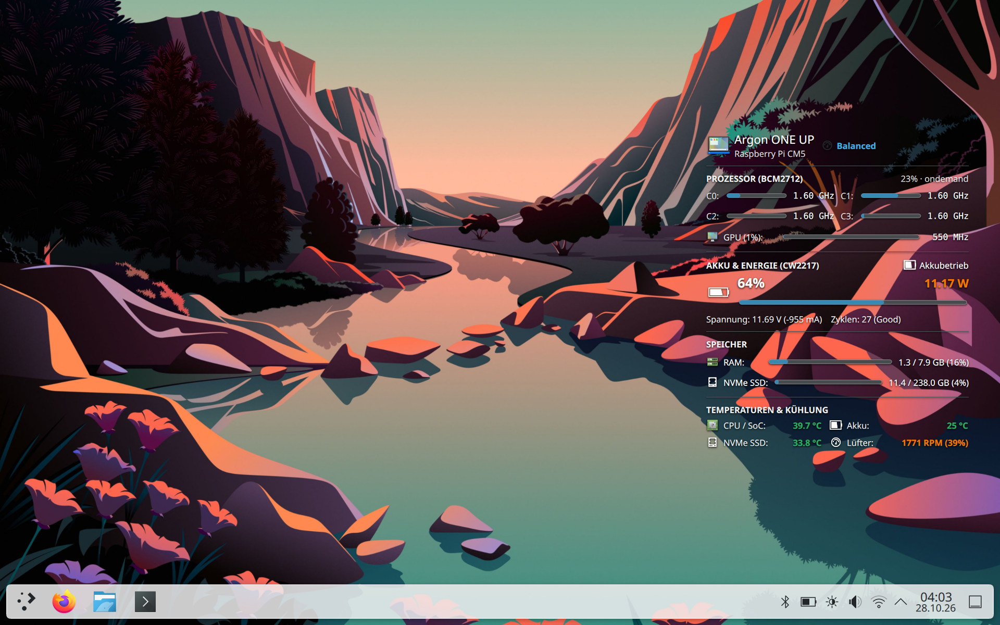

# Argon ONE UP Suite

[](https://github.com/GamingTux/argon-oneup-suite/releases)
[](https://www.raspberrypi.com/)
[](LICENSE)

Vollständige Hardware-Treiber-, Energie- und Desktop-Integrations-Suite für das **Argon ONE UP Laptop** (basierend auf dem Raspberry Pi Compute Module 5 / Pi 5).

Diese Suite stellt sicher, dass alle Hardware-Komponenten des Laptops (Akku, Display-Helligkeit, Deckelschalter, Lüfter, Powermanagement, Desktop-Telemetrie und Ruhezustand) „Out-of-the-Box“ unter Standard-Linux-Distributionen (Raspberry Pi OS 64-Bit, Debian, Ubuntu) nahtlos und nach offiziellen Kernel-Standards funktionieren.



---

## 📦 Komponenten der Suite

Die Suite ist modular in **8 eigenständige Debian-Pakete** aufgeteilt. Jedes Paket kann einzeln installiert werden oder zusammen über das Metapaket:

| Paket | Typ | Beschreibung |
| :--- | :---: | :--- |
| [**`argon-oneup-plasma-widget`**](src/argon-oneup-plasma-widget) | `arm64` | **KDE Plasma 6 Desktop-Dashboard (`org.argon.oneup.dashboard`):** Zeigt in Echtzeit CPU-Last & Takt pro Kern, VideoCore VII (V3D) GPU-Last & Takt, CW2217 Akku-Telemetrie (Watt, Spannung, Zyklen), RAM/NVMe/USB-Speicherbelegung, Temperaturen (SoC, Akku, NVMe) sowie Lüfterdrehzahl (RPM) und ermöglicht das direkte Umschalten der Energieprofile (*Eco*, *Balanced*, *Turbo*). Nutzt ein kompiliertes Cortex-A76 C-Backend ohne CPU-Overhead. |
| [**`argon-oneup-battery`**](src/argon-oneup-battery) | `all` | Nativer Linux Kernel `power_supply` Treiber (DKMS) für den Cellwise CW2217 Fuel-Gauge-Chip. Bindet Akku (`BAT0`) und Netzteil (`AC0`) direkt in UPower, KDE Plasma und systemd-logind ein (inkl. dynamischer Restlaufzeitberechnung und Notfall-Shutdown bei kritischem Akkustand). |
| [**`argon-oneup-backlight`**](src/argon-oneup-backlight) | `all` | Verbindet das interne DDC/CI-Display auf I2C-Bus 14 mit dem Standard Linux `/sys/class/backlight`-Subsystem. Ermöglicht hardwarenahe Helligkeitssteuerung über Funktionstasten, Schieberegler und OSD in allen Desktop-Umgebungen (KDE, Wayfire, Labwc, GNOME). |
| [**`argon-oneup-lid`**](src/argon-oneup-lid) | `all` | Bindet den physischen Hall-Effekt-Magnetschalter am Displaydeckel auf GPIO 27 via Device Tree Overlay als echten Linux-Input-Switch (`SW_LID` / `EV_SW`) ein. |
| [**`argon-oneup-sensors`**](src/argon-oneup-sensors) | `arm64` | Leitet alle physischen Hardware-Sensoren (CPU-Temperatur, PWM-Lüfterdrehzahl, NVMe-Temperatur, Akku-Telemetrie) standardkonform über `lm-sensors` weiter. Behebt zudem den KDE Plasma 6 `ksystemstats` ARM64 Deadlock ([KDE Bug #493093](https://bugs.kde.org/show_bug.cgi?id=493093)). |
| [**`argon-power-profiles`**](src/argon-power-profiles) | `all` | Drop-in Ersatz für den `power-profiles-daemon` auf ARM64/Raspberry Pi. Stellt D-Bus-APIs für KDE/GNOME bereit und regelt dynamisch CPU-Governors (1.5 GHz bis Max), WLAN-Energiesparmodus und Backlight-Profile (*Quiet*, *Balanced*, *Performance*). |
| [**`cm5-mmc-fix`**](src/cm5-mmc-fix) | `all` | Behebt den 30–80 Sekunden langen Shutdown/Reboot-Hang auf dem Raspberry Pi CM5 Lite bei leerem MicroSD-Slot (BCM2712 SDHCI Hardware-Timeout Bug). |
| [**`rpi-fake-sleep`**](src/rpi-fake-sleep) | `all` | Universeller Standby/Ruhezustand-Manager für Raspberry Pi. Friert Prozesse über cgroups v2 ein, parkt die Kerne C1–C3 per Single-Core-`cpuset`/Workqueue-Pinning dauerhaft im Hardware-`WFI` (sodass nur `C0` für das Aufwach-Event zuständig bleibt), taktet die CPU herunter, schaltet Display & Tastatur-USB-Strom ab und senkt den Standby-Verbrauch auf **3,86 W (< 300 mA)** bei <1 ms Aufwachzeit. |
| [**`argon-oneup-suite`**](src/argon-oneup-suite) | `all` | **Metapaket:** Installiert mit einem einzigen Befehl alle oben genannten Pakete als gemeinsame Gesamtsuite. |

---

## ⚡ Energieverbrauch & Benchmarks (`v1.2.0`)

Gemessen auf dem **Argon ONE UP Laptop** (Raspberry Pi Compute Module 5 Lite, 8 GB RAM, 256 GB NVMe SSD, 55,21 Wh / 4800 mAh 3S1P Li-Po Akku, Debian 13 Trixie, KDE Plasma 6) mit dem integrierten Benchmark-Tool `sudo argon-power-bench`:

| Betriebszustand | Ø Gesamtleistung (3S) | Min .. Max | Ø Zell-Leistung | Ø Strom (`I`) | SoC-Temperatur | Reale Akkulaufzeit |
| :--- | :---: | :---: | :---: | :---: | :---: | :---: |
| **Leerlauf (Idle)** *(KDE Plasma 6 aktiv, 70 % Display)* | **9,83 W** | `9,76 .. 10,70 W` | `3,28 W` | `-766,6 mA` | `35,9 – 38,6 °C` | **ca. 5,6 Std.** |
| **Volllast (Load)** *(4 Kerne 100 % @ 2,80 GHz)* | **15,54 W** | `14,82 .. 16,49 W` | `5,18 W` | `-1228,4 mA` | `44,1 – 52,9 °C` | **ca. 3,6 Std.** |
| **Fake-Sleep (60s Gesamtschnitt)** *(inkl. 18s Nachlauf nach Volllast)* | **4,34 W** | `3,86 .. 5,19 W` | `1,45 W` | `-337,4 mA` | `37,0 – 43,0 °C` | **ca. 12,7 Std.** |
| **Fake-Sleep (Steady-State)** *(eingeschwungen ab Sekunde 19)* | **3,91 W** | **`3,86 .. 3,98 W`** | **`1,30 W`** | **`-303,6 mA`** | `37,0 – 39,7 °C` | **ca. 14,1 Std.** |

* **Über 60 % Ersparnis im Standby:** Im eingeschwungenen Fake-Sleep (`3,86 – 3,91 W` / `~300 mA`) verbraucht das gesamte System fast **6 Watt weniger** als im normalen Desktop-Leerlauf (`9,83 W`) und wacht bei Tastendruck oder Öffnen des Displaydeckels verzögerungsfrei auf.
* **CPU-Performance (Geekbench 7.1.0 ARM64 @ 2,80 GHz):**
  * **KDE Plasma 6 Desktop aktiv:** **902 Single-Core / 2.206 Multi-Core** ([Ergebnis ansehen](https://browser.geekbench.com/v7/cpu/740896))
  * **Reine Konsole (ohne GUI):** **919 Single-Core / 2.316 Multi-Core** ([Ergebnis ansehen](https://browser.geekbench.com/v7/cpu/740978))

---

## 🚀 Installation

Alle Pakete stehen im [**aktuellen GitHub Release (v1.2.1)**](https://github.com/GamingTux/argon-oneup-suite/releases/latest) zum Download bereit.

### Option A: Gesamte Suite installieren (Empfohlen)

Lade die `.deb`-Pakete des aktuellen Releases herunter und installiere sie mit `apt`:

```bash
# Alle Pakete des Releases installieren (inkl. KDE Plasma Dashboard Widget)
sudo apt update
sudo apt install ./argon-*.deb ./cm5-mmc-fix_*.deb ./rpi-fake-sleep_*.deb
```

---

### Option B: Einzelne Pakete nach Bedarf installieren

Wenn du nur bestimmte Funktionen (z. B. das KDE Plasma Dashboard, die Akkuanzeige oder die Helligkeitssteuerung) nutzen möchtest:

```bash
# Beispiel: KDE Plasma 6 Dashboard Widget installieren
wget https://github.com/GamingTux/argon-oneup-suite/releases/download/v1.2.1/argon-oneup-plasma-widget_1.1.9_arm64.deb
sudo apt install ./argon-oneup-plasma-widget_1.1.9_arm64.deb

# Beispiel: Nur Akku-Treiber installieren
wget https://github.com/GamingTux/argon-oneup-suite/releases/download/v1.2.1/argon-oneup-battery_1.1.8_all.deb
sudo apt install ./argon-oneup-battery_1.1.8_all.deb

# Beispiel: Nur Helligkeits-Treiber installieren
wget https://github.com/GamingTux/argon-oneup-suite/releases/download/v1.2.1/argon-oneup-backlight_1.1.0_all.deb
sudo apt install ./argon-oneup-backlight_1.1.0_all.deb
```

---

### Option C: Offline-Komplettpaket (All-in-One Tarball)

Für Neuinstallationen ohne aktive Internetverbindung:

```bash
# 1. Komplett-Archiv entpacken
tar -xzf argon-oneup-suite_1.0.0.tar.gz
cd argon-oneup-suite-1.0.0

# 2. Automatisches Installationsskript ausführen
sudo ./install.sh
```

---

## 🛠️ Aus dem Quellcode bauen

Um alle Debian-Pakete selbst aus dem Quellcode zu erstellen:

```bash
git clone https://github.com/GamingTux/argon-oneup-suite.git
cd argon-oneup-suite

# Bauskript ausführen
./build_packages.sh
```
Die fertigen `.deb`-Dateien liegen anschließend im Ordner `dist/`.

---

## 📄 Lizenz

Dieses Projekt steht unter der [MIT Lizenz](LICENSE).  
Alle Treiber und Overlays sind Open-Source und für die Raspberry Pi Community frei nutzbar.
